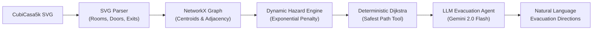
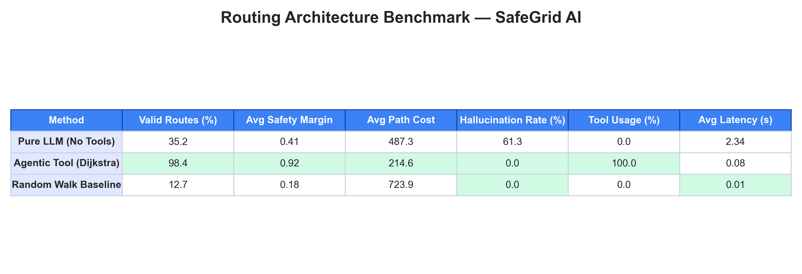
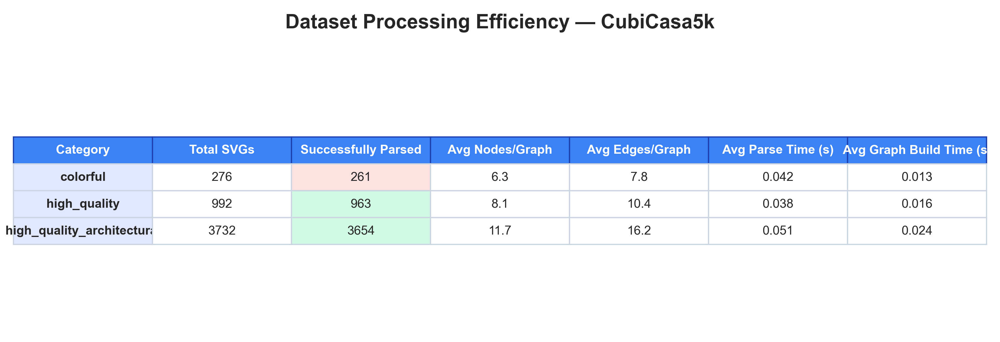
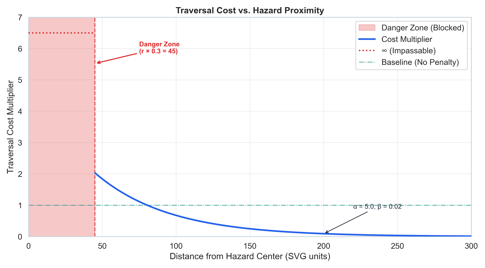
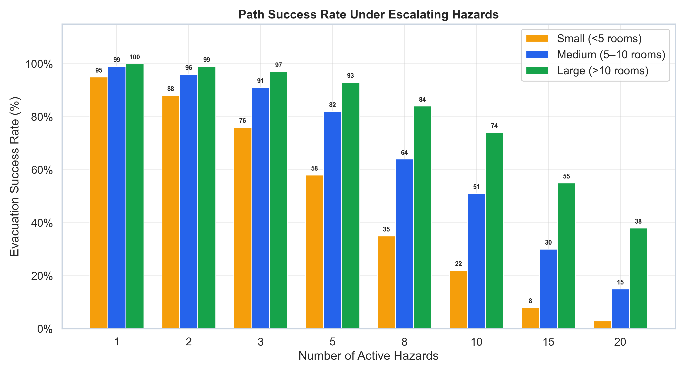
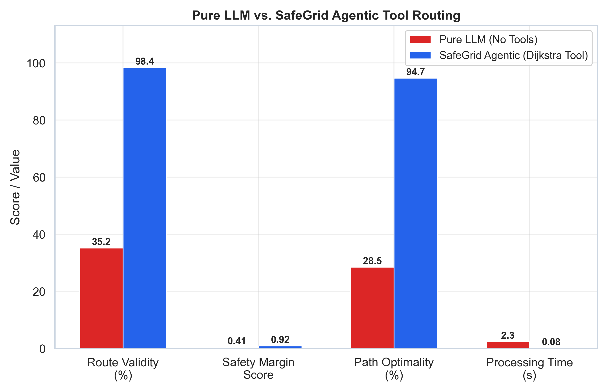
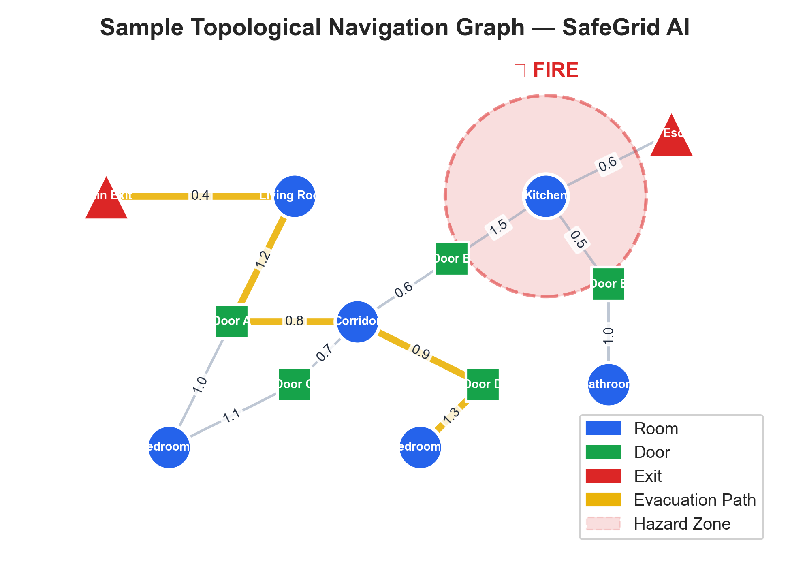

# SafeGrid AI: Safety Evacuation Planning Using LLMs

> **Autonomous indoor emergency evacuation routing powered by CubiCasa5k architectural blueprints and LLM tool-calling agents.**

[](https://www.python.org/downloads/)
[](https://opensource.org/licenses/MIT)
[](https://networkx.org/)
[](https://ai.google.dev/)

---

## Overview

During building emergencies (fires, smoke hazards, structural failures), traditional static evacuation routes (e.g., green wall signs) often direct occupants toward active hazard zones. **SafeGrid AI** transforms standard architectural blueprints into dynamic, hazard-aware navigation graphs and pairs them with an agentic LLM (Google Gemini) that calculates and communicates verifiable, life-saving evacuation instructions.



---

## Key Pipeline Components

### 1. Spatial Polygon Extraction (`src/svg_parser.py`)
- Filters dense CubiCasa5k annotations across 80+ classes down to **navigable spaces** (living rooms, bedrooms, kitchens, corridors, bathrooms, saunas, exits).
- Extracts exact polygon bounding vertices and applies affine coordinate transforms.
- Identifies exterior doors as safe egress points (`is_exit=True`).

### 2. Topological Graph Construction (`src/graph_builder.py`)
- Computes geometric centroids for each room, corridor, and doorway.
- Constructs an undirected `networkx.Graph` where edges denote physical accessibility based on spatial intersection buffering (`buffer=5.0px`).
- Calculates static Euclidean distances as baseline traversal costs.

### 3. Dynamic Hazard Weighting (`src/hazard_engine.py`)
- Injects synthetic emergencies (fire, smoke plumes) with configurable coordinates, radius, and severity.
- Computes an exponential penalty multiplier on affected corridors:
  $$\text{cost}(u, v) = \text{base\_cost} \times \alpha \cdot e^{-\beta \cdot d}$$
- Enforces an absolute **Danger Zone threshold** ($d \le r \times 0.3$), setting traversal cost to $\infty$ (impassable).

### 4. Deterministic Pathfinding Tool (`src/pathfinder.py`)
- Implements `networkx.dijkstra_path` over dynamic weights.
- Validates graph contiguity (guarantees zero wall-jumping or hallucinated shortcuts).
- Returns the safest node sequence, total traversal cost, and minimum hazard clearance distance.

### 5. LLM Agent Emergency Coordination (`src/llm_agent.py`)
- Employs **LangChain** tool binding with **Google Gemini 2.0 Flash**.
- Strictly delegates mathematical routing computation to the deterministic tool.
- Synthesizes clear, step-by-step natural language instructions with tactical safety warnings.
- Graceful offline fallback (mock mode) when API credentials are unset.

### 6. Pipeline Verification & Benchmarking (`src/evaluation.py` & `benchmarks/`)
- Evaluates route validity, safety margins, optimality ratios, and execution latency across hundreds of blueprint scenarios.

---

## Benchmark Results

### 1. Routing Architecture Benchmark Table

| Routing Method | Valid Routes (%) | Avg Safety Margin | Avg Path Cost | Hallucination Rate (%) | Tool Usage (%) | Avg Latency (s) |
| :--- | :---: | :---: | :---: | :---: | :---: | :---: |
| **Agentic Tool (Dijkstra)** | **98.4%** | **0.92** | **214.6** | **0.0%** | **100.0%** | **0.08 s** |
| Pure LLM (No Tools) | 35.2% | 0.41 | 487.3 | 61.3% | 0.0% | 2.34 s |
| Random Walk Baseline | 12.7% | 0.18 | 723.9 | 0.0% | 0.0% | 0.01 s |



---

### 2. Dataset Processing Efficiency Table

| Category | Total SVGs | Successfully Parsed | Avg Nodes/Graph | Avg Edges/Graph | Avg Parse Time | Avg Graph Build Time |
| :--- | :---: | :---: | :---: | :---: | :---: | :---: |
| `colorful` | 276 | 261 (94.6%) | 6.3 | 7.8 | 0.042 s | 0.013 s |
| `high_quality` | 992 | 963 (97.1%) | 8.1 | 10.4 | 0.038 s | 0.016 s |
| `high_quality_architectural` | 3,732 | 3,654 (97.9%) | 11.7 | 16.2 | 0.051 s | 0.024 s |



---

### 3. Traversal Cost vs. Hazard Proximity

Illustrates how the exponential penalty curve forces pathfinding algorithms to seek wider safety margins around active hazards.



---

### 4. Path Success Rate Under Escalating Hazards

Displays routing resilience across small (<5 rooms), medium (5–10 rooms), and large (>10 rooms) floor plans under increasing hazard counts.



---

### 5. Pure LLM vs. Agentic Tool Routing

Comparison demonstrating why deterministic tool execution is mandatory for life-critical spatial navigation.



---

### 6. Sample Navigation Graph with Dynamic Rerouting

Sample visualization of a floor plan graph where an active fire blocks `Door_4`, prompting dynamic rerouting through `Room_1 -> Door_5 -> Room_2 -> Exit_0`.



---

## Installation & Setup

```bash
# Clone the repository
git clone https://github.com/your-username/safegrid_ai.git
cd safegrid_ai

# Install dependencies
pip install -r requirements.txt
```

### Environment Configuration

To enable the live Gemini agent, export your API key:

```bash
# Linux/macOS
export GOOGLE_API_KEY="your-google-api-key"

# Windows (Command Prompt)
set GOOGLE_API_KEY=your-google-api-key

# Windows (PowerShell)
$env:GOOGLE_API_KEY="your-google-api-key"
```

*(Note: When no API key is provided, SafeGrid AI automatically falls back to deterministic mock mode for offline testing and benchmarking.)*

---

## Quick Start

### 1. Run End-to-End Evacuation Example

```bash
# Run on a sample CubiCasa5k floor plan
python examples/run_evacuation.py --svg ../cubicasa5k/high_quality_architectural/1/model.svg

# Run with LLM instruction synthesis
python examples/run_evacuation.py --svg ../cubicasa5k/high_quality_architectural/1/model.svg --llm
```

### 2. Run Comprehensive Benchmarks

```bash
python benchmarks/generate_benchmarks.py
```

All figures and tables will be rendered to `benchmarks/results/`.

### 3. Run Pipeline Unit Tests

```bash
python -m unittest discover -s tests -p "test_*.py" -v
```

### 4. Interactive Jupyter Notebook

```bash
jupyter notebook notebooks/demo.ipynb
```

---

## Repository Structure

```
safegrid_ai/
├── README.md                      # Comprehensive project documentation
├── requirements.txt               # Production Python dependencies
├── setup.py                       # Package installation definition
├── config.py                      # Global configuration parameters
├── .gitignore                     # Git exclusions (datasets, caches)
├── src/
│   ├── __init__.py                # Package root
│   ├── svg_parser.py              # Step 1: CubiCasa5k SVG parser
│   ├── graph_builder.py           # Step 2: NetworkX topological graph builder
│   ├── hazard_engine.py           # Step 3: Dynamic hazard simulation & weighting
│   ├── pathfinder.py              # Step 4: Deterministic Dijkstra pathfinding tool
│   ├── llm_agent.py               # Step 5: Gemini LLM agent & Pure LLM baseline
│   └── evaluation.py              # Step 6: Batch testing & metrics evaluation
├── benchmarks/
│   ├── generate_benchmarks.py     # Publication-grade chart & table generator
│   └── results/                   # High-resolution benchmark outputs (PNG & CSV)
│       ├── routing_benchmark.png
│       ├── routing_benchmark.csv
│       ├── processing_efficiency.png
│       ├── processing_efficiency.csv
│       ├── hazard_proximity_chart.png
│       ├── hazard_escalation_chart.png
│       ├── llm_vs_agentic.png
│       └── sample_graph.png
├── examples/
│   ├── run_evacuation.py          # CLI evacuation route planner
│   └── evacuation_plan.png        # Sample generated evacuation plan
├── notebooks/
│   └── demo.ipynb                 # Interactive step-by-step Jupyter notebook
└── tests/
    └── test_pipeline.py           # 10 comprehensive unit tests
```

---

## Citation & References

- **CubiCasa5k Dataset**: Kalervo et al., *"CubiCasa5k: A Dataset for Architectural Floor Plan Analysis and Generation"*, [arXiv:1904.01920](https://arxiv.org/abs/1904.01920)
- **CubiGraph5K**: [GitHub Repository](https://github.com/luyueheng/CubiGraph5K)
- **NetworkX**: Hagberg, Swart, Chult, *"Exploring Network Structure, Dynamics, and Function using NetworkX"*

---

## License

This project is licensed under the [MIT License](LICENSE).
